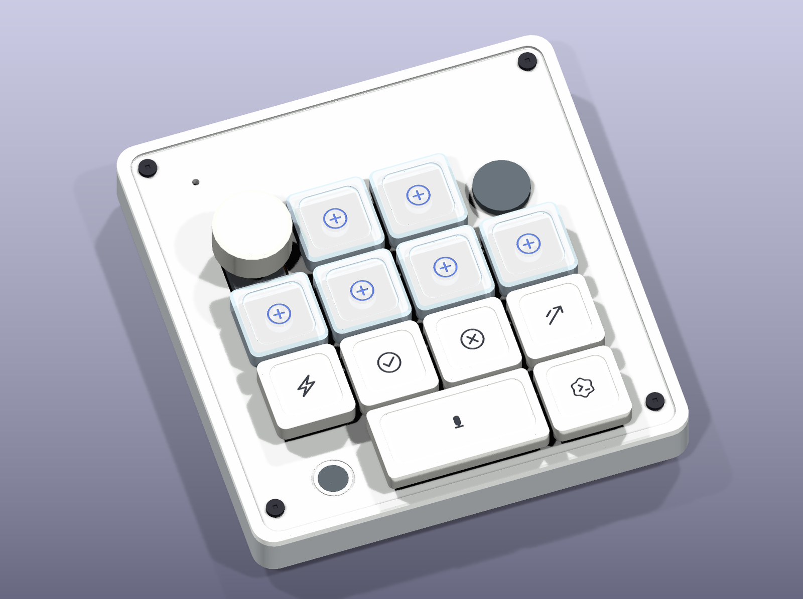
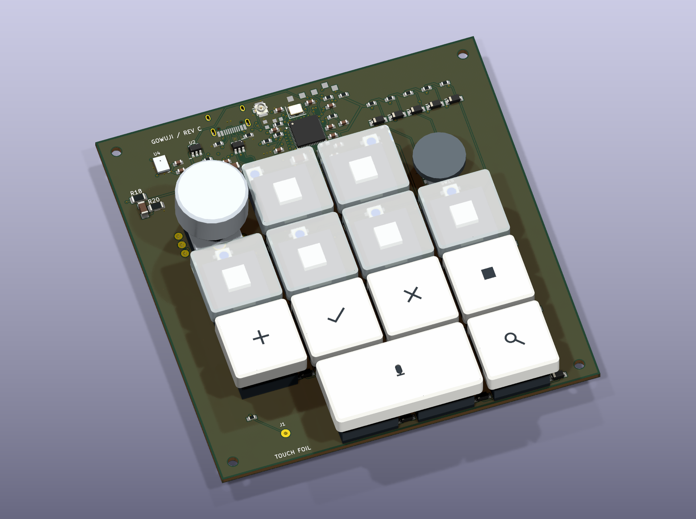
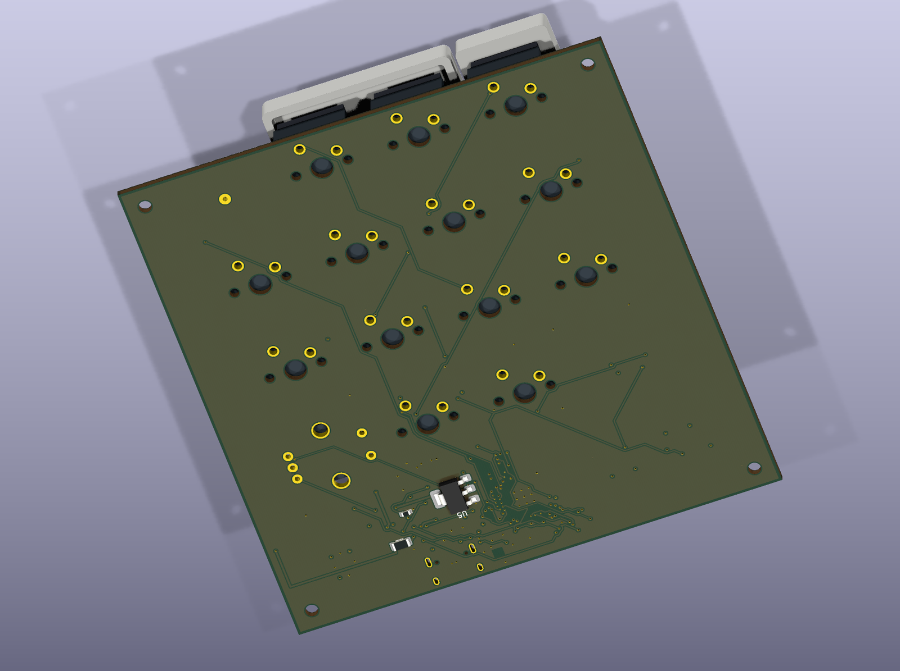
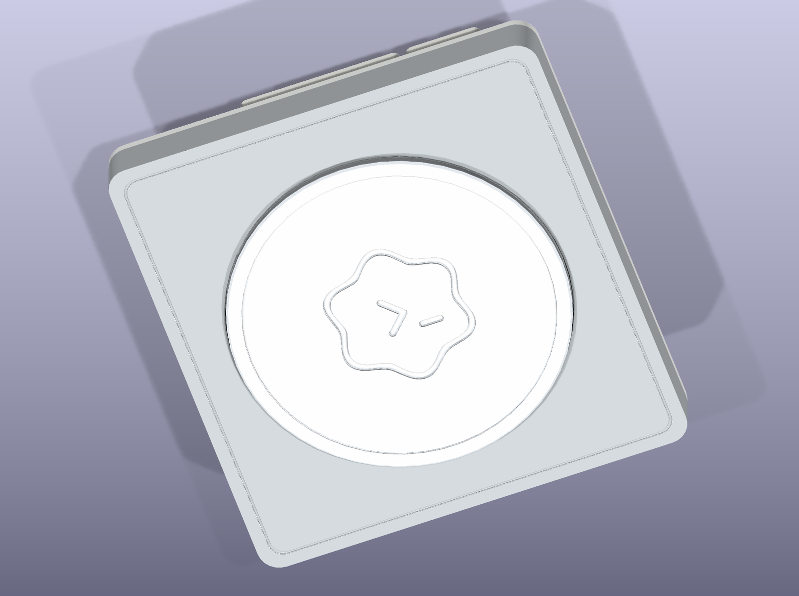
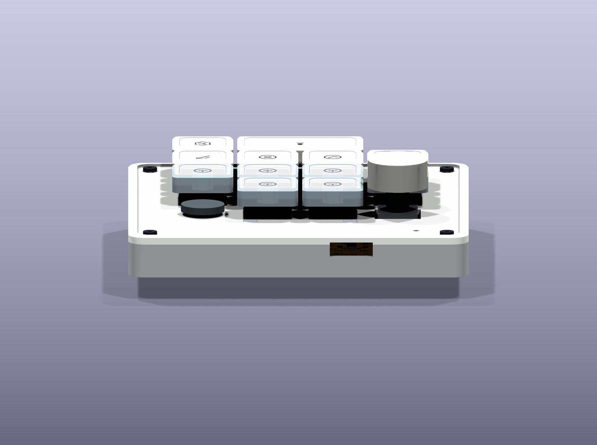
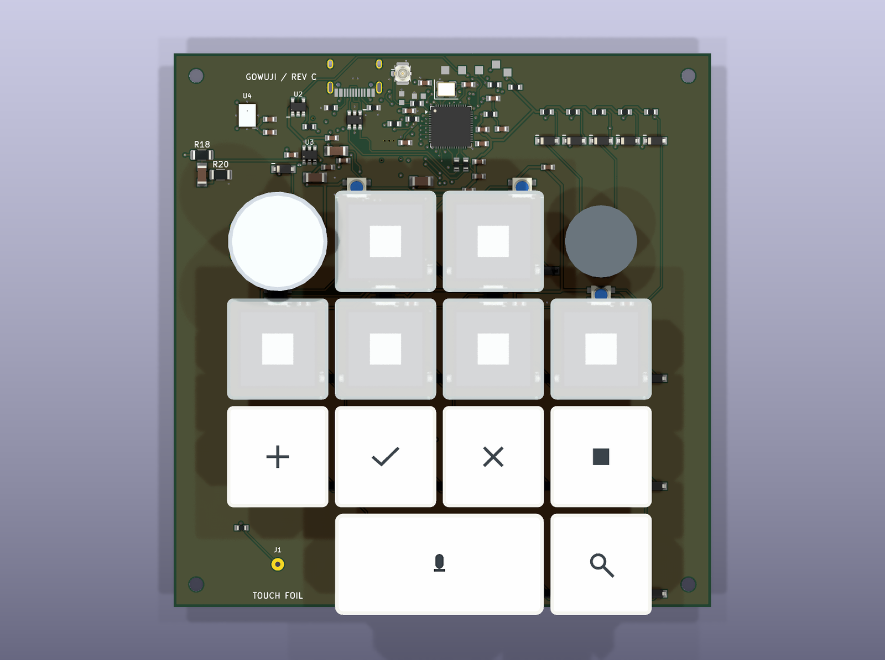

# GOWUJI Macro Pad

<p align="center">
  
</p>

<p align="center"><sub><b>Rev C 工程样机</b> · 带壳 3D 渲染（CAD 渲染，非实物照片）</sub></p>

| **PCB 正面** · 4 层 · 95 × 98 mm | **PCB 背面** · 电源与地平面 |
| :---: | :---: |
|  |  |

> **当前工程候选：Rev C（REVIEW ONLY）**。四层板、直接贴装 ESP32-S3、独立 LED 5 V 阻尼支路；ERC/DRC/一致性 0，板级仿真通过，但**尚未下单、未做实物验证**。源文件在 [hardware/rev-c/](hardware/rev-c/)，验证记录见 [AGENTS.md](AGENTS.md)；Rev B 下单说明见 [docs/rev-b-order.md](docs/rev-b-order.md)。

> **Rev B PCB + 工厂贴装打样**：使用[Rev B 下单说明](docs/rev-b-order.md)和本地 `build/rev-b-pcba.zip`；工厂 CAM/供料/旋转回签后做 3–5 套工程样机。下方 A4 的双层板和成本不能代用。

<details>
<summary>更多 3D 渲染</summary>

| 背面 | 后侧 USB-C | PCB 正上方 |
| :---: | :---: | :---: |
|  |  |  |

</details>

## Rev A4 DIY 基线

按 [OpenAI × Work Louder Codex Micro](https://openai.com/zh-Hans-CN/supply/co-lab/work-louder/) 键位设计的 DIY 控制台。采用 95 × 98 mm 双层 PCB、Waveshare ESP32-S3-Zero-M、13 个直焊 MX 轴（其中两个共用 2U 语音键帽）、六颗独立状态灯、五向摇杆、带按压旋钮和触摸片。外壳、面板、旋钮、导光件和 2U 键帽可打印。当前是 **Alpha 样机设计**，尚未做实物验证。

| 交付 | 文件 |
| --- | --- |
| PCB、原理图、项目库 | [KiCad 项目](hardware/Gowuji-RevA.kicad_pro)、[PCB](hardware/Gowuji-RevA.kicad_pcb)、[原理图](hardware/Gowuji-RevA.kicad_sch) |
| BOM | [BOM.csv](hardware/BOM.csv) |
| 3D 打印 | [底壳](mechanical/base.stl)、[面板](mechanical/plate.stl)、[旋钮](mechanical/dial.stl)、[摇杆帽](mechanical/joystick-cap.stl)、[导光件](mechanical/light-pipes.stl)、[2U 语音键帽](mechanical/ptt-keycap-2u.stl)、[USB 盖](mechanical/usb-cover.stl)、[轴孔试片](mechanical/mx-fit-coupon.stl)、[装配 STEP](mechanical/fit-reference.step) |
| 可选外壳 | [按参考图制作的凹刻圆盘和正面选件](docs/appearance.md) |
| Rev B 布线已闭合，待打样验证 | [直接贴装 ESP32-S3、后置 USB-C 和连续正面](docs/rev-b.md) |
| 固件和烧录 | [Arduino 工程](firmware/Gowuji/)、[烧录脚本](firmware/flash.py) |
| Codex 伴侣 | [Python 主机程序](host/gowuji.py) |
| 制造与验证 | [打样和装配](docs/assembly.md)、[验证记录](docs/validation.md) |

有线模式使用标准 USB HID 键盘；打开伴侣应用并连接 USB 串口后，按键事件改由伴侣处理。按住旋钮再按复位，选择本次开机使用 BLE HID。无线模式需要通过 USB-C 外接 5 V 电源；Rev A 无电池、充电器和无线状态灯同步。普通开机恢复 USB HID。蓝牙配对和 USB 真机枚举尚未验证。

伴侣应用启动独立的 [Codex App Server](https://learn.chatgpt.com/docs/app-server)，不用原厂 VID/PID 或专有协议。它管理自己启动或接入的聊天；不能保证追踪官方桌面应用里正在运行的聊天，也不会出现在原厂设备配置页。旋钮选择下一次发送使用的推理强度，摇杆把提示词填入输入框。A4 的板载数字麦克风通过 USB 传送 16 kHz 单声道 PCM 给伴侣，由本地 Vosk 转写。按住 2U 键采样，松开停止，每次最多 60 秒；系统录音应用和 BLE 模式不提供板载音频。语音和摇杆都只填入草稿，由用户点发送。按键接受/拒绝只对当前会话中已经显示的命令或文件审批有效。

PCB 上六颗灯靠近上方六个磨砂透光状态键，通过面板导光；六个位置映射到伴侣的聊天槽。状态为：无分配熄灭、空闲白、运行蓝、完成绿、待输入黄、错误红。左下触摸片切换六个配置层；底部宽键下两轴合并为一个按住说话事件。传入 `--profiles host/profiles.example.json` 可替换每层的摇杆提示词和部分命令键；标准 HID 模式保持固定键值。

| 位置 | 第 1 列 | 第 2 列 | 第 3 列 | 第 4 列 |
| --- | --- | --- | --- | --- |
| 第 1 排 | 旋钮 | 会话 1 | 会话 2 | 摇杆 |
| 第 2 排 | 会话 3 | 会话 4 | 会话 5 | 会话 6 |
| 第 3 排 | 新聊天 | 接受 | 拒绝 | 中止当前回合 |
| 第 4 排 | 触摸切层 | 按住说话（2U 左） | 同一键（2U 右） | 查找 / 分配 |

成本估算约 **¥63–170 / 套**，含小批量摊销裸 PCB 和自打耗材，不含人工、运费、代贴和外置电源。板载麦克风、阻容和密封圈约增加 ¥3–10。六个状态位用磨砂透光 1U MX 键帽，其余单宽命令键可复用通用键帽。量产前必须完成 [USB 与整机首件验证](docs/validation.md)。

本地编译和启动：

```powershell
python tools/build_firmware.py --install
python -m pip install esptool==5.1.0
python firmware/flash.py COM6 GOWUJI-v0.1.0-alpha.4-flash-0x0.bin
python -m pip install -r host/requirements.txt
python host/gowuji.py --port COM6 --cwd C:/path/to/project
```

上面用的是 Windows 示例端口；macOS/Linux 替换成对应串口路径。无需硬件可用 `python host/gowuji.py --demo` 查看灯状态。语音可选装 `host/requirements-voice.txt`，下载匹配语言的 [Vosk 模型](https://alphacephei.com/vosk/models)，并启动时增加 `--voice-model <模型目录>`。若使用 A3 或希望改用电脑麦克风，另装 `sounddevice`，并增加 `--mic computer`。

硬件使用 KiCad 9 打开。修改源数据后可用 `python tools/hardware.py` 更新原理图、BOM、项目库及固件引脚；该命令不会覆写已布线 PCB。若重新布局，`--unrouted build/layout.kicad_pcb` 生成裸布局，再在 KiCad 中布线并另存。用 `python mechanical/generate.py`（CadQuery 2.8）重建机械文件。用 `python tools/export_hardware.py` 重跑检查和制造导出。Release 同时提供可烧录的完整镜像、源码和 Gerber，发布状态见 [AGENTS.md](AGENTS.md)。

在 PCB 编辑器按 `Alt+3` 查看装有器件的板。`hardware/models/` 内含简化的按键、模块、旋钮、摇杆和麦克风 STEP，可用 `python mechanical/kicad_models.py` 重建。`python tools/export_hardware.py --render` 额外生成电路板和带外壳两张 KiCad 渲染图。A4 延用 A3 对齐原厂的键位及按键分区，采用通用 MX 轴、打印外壳和独立伴侣程序；命令默认映射、手感、材料及灯光效果与原厂可能不同。
